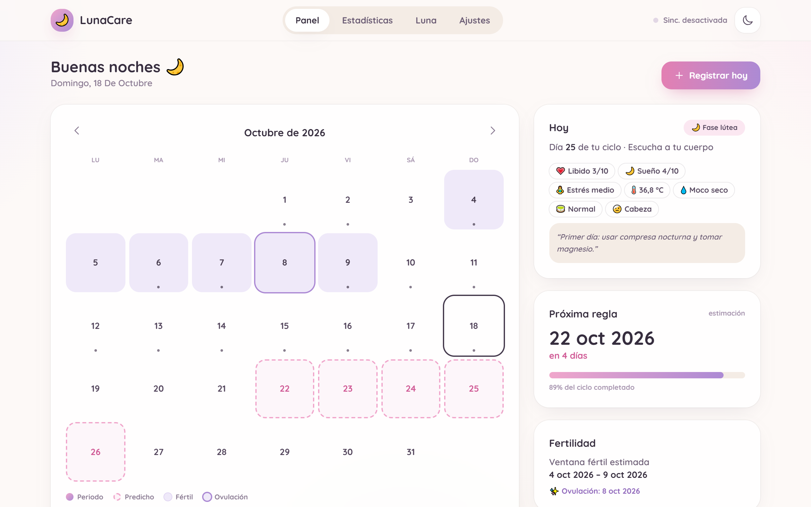
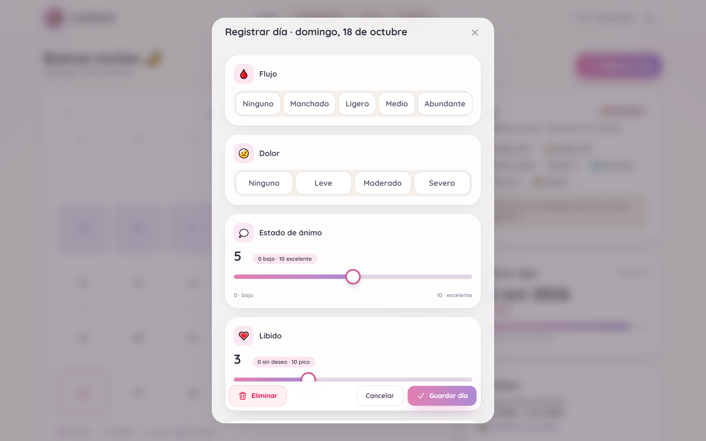
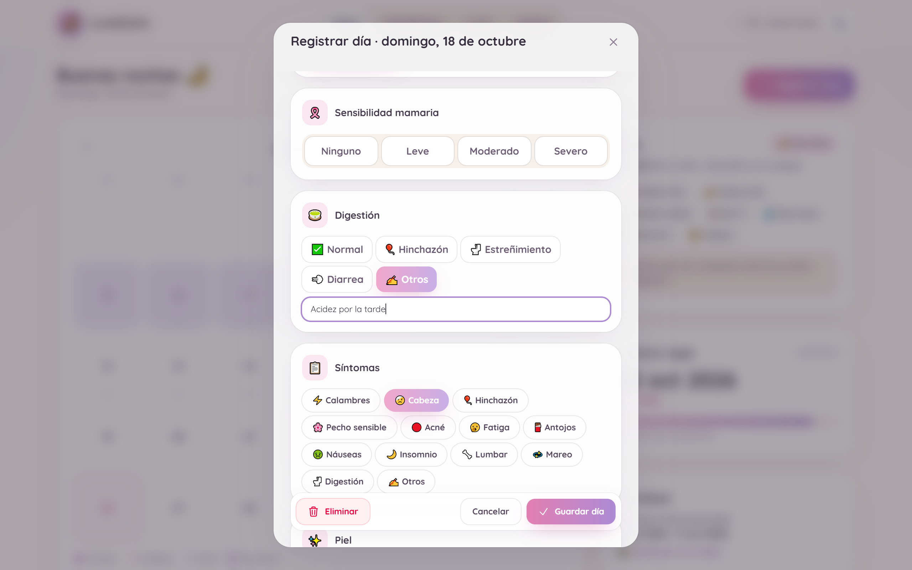
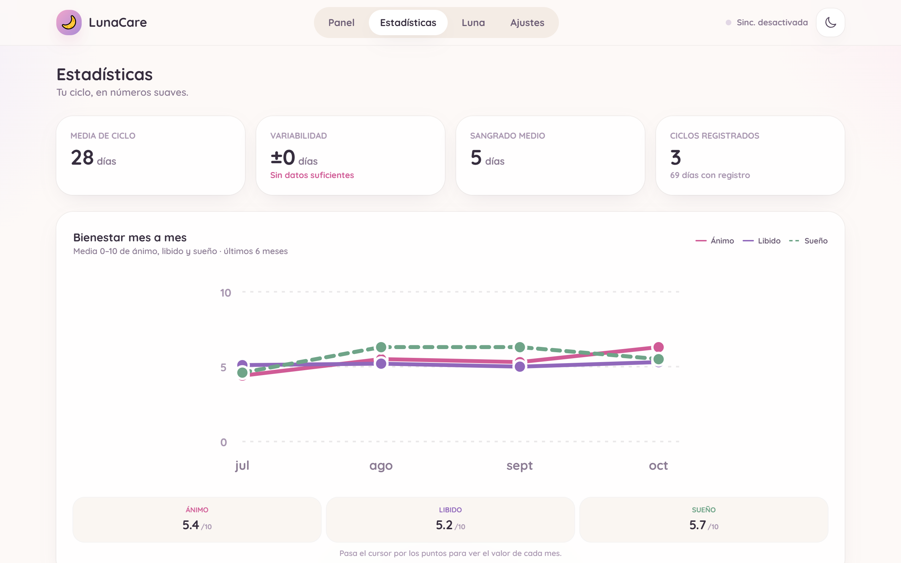
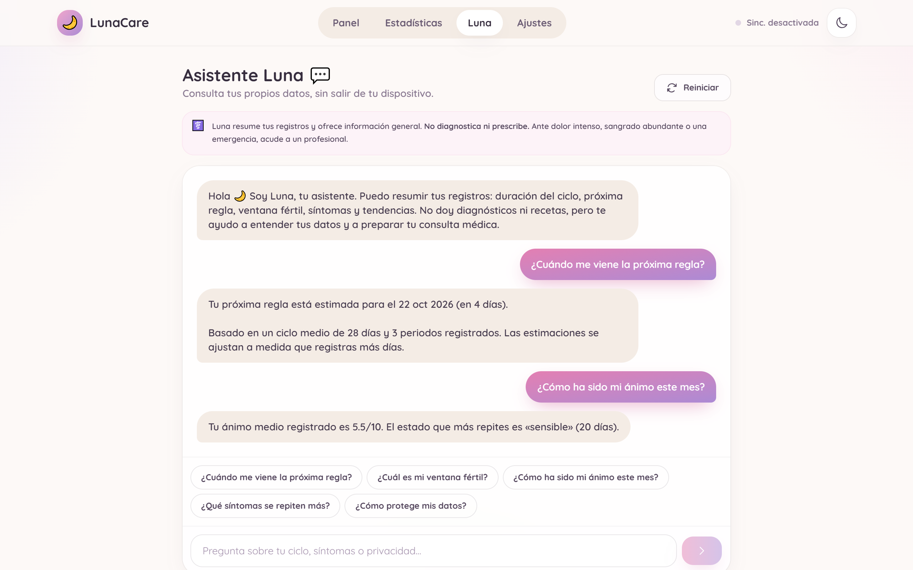
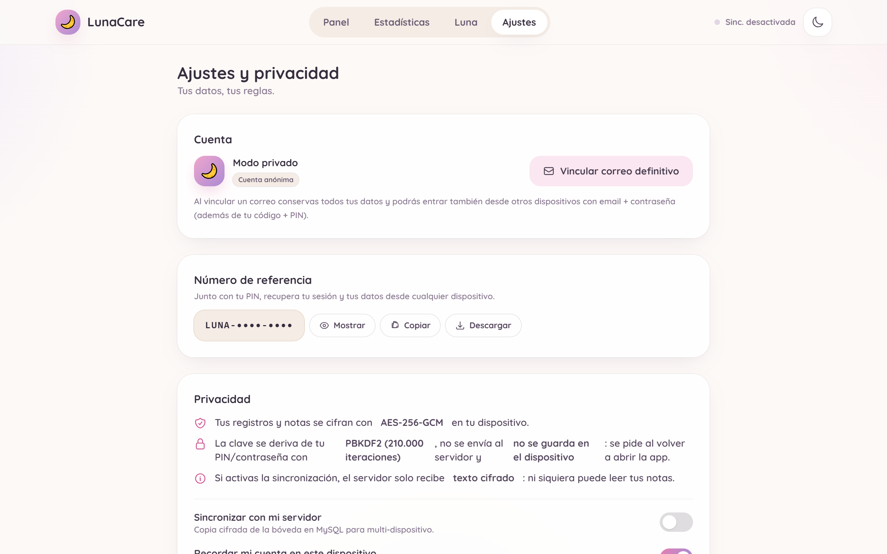
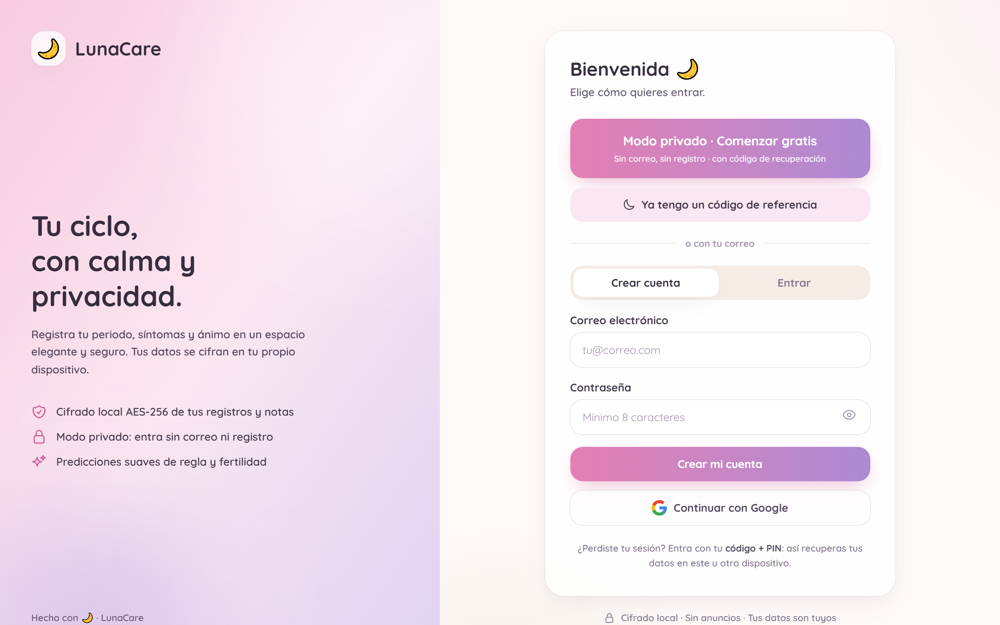
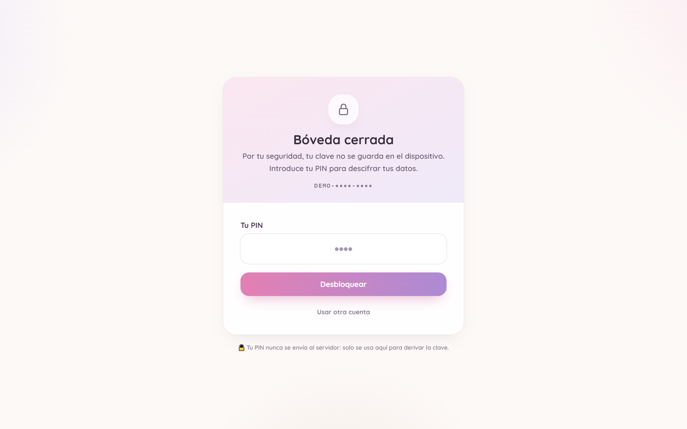
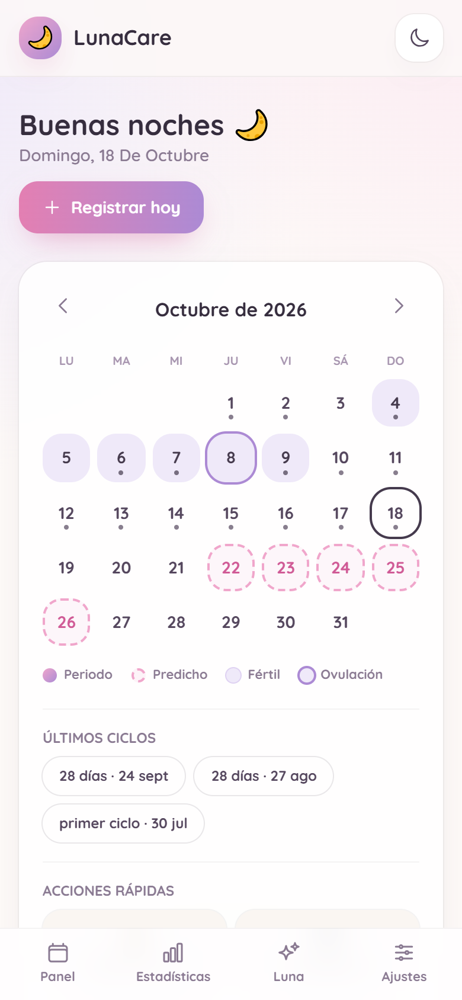
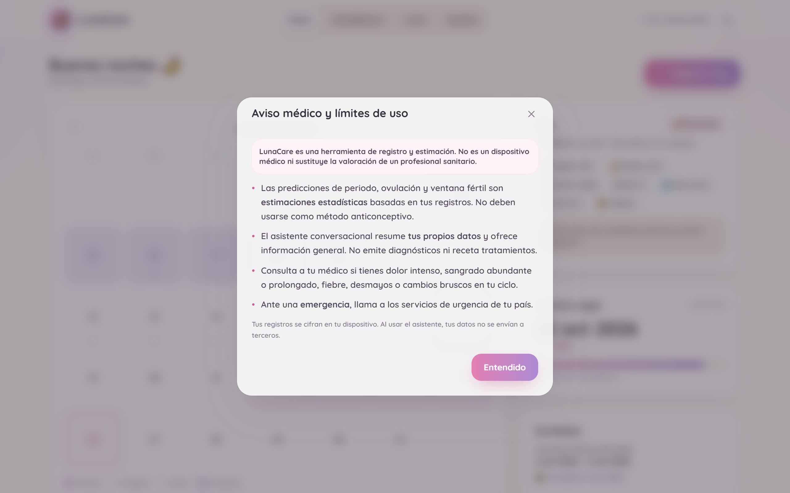

# 🌙 LunaCare

> **Tu ciclo, con calma y privacidad.** Seguimiento menstrual de código abierto: cifrado en el
> dispositivo, 100 % usable sin conexión y sin rastreo de ningún tipo.

<p align="center">
  
</p>

<p align="center">
  
  
  
  
  
  
  
  
</p>

<p align="center">
  <a href="#-puesta-en-marcha"><b>Empezar</b></a> ·
  <a href="docs/arquitectura.md">Arquitectura</a> ·
  <a href="docs/privacidad.md">Privacidad</a> ·
  <a href="docs/cuentas.md">Cuentas</a> ·
  <a href="#-capturas">Capturas</a> ·
  <a href="CONTRIBUTING.md">Contribuir</a>
</p>

---

## ✨ Qué es LunaCare

Una PWA para registrar el ciclo menstrual y entenderlo: calendario, síntomas, ánimo, sueño y notas
personales, con **cifrado AES-256-GCM en el propio dispositivo**. Funciona sin registro, sin conexión
y sin backend; si quieres sincronizar entre dispositivos, despliegas una API PHP minúscula que solo
almacena **bytes cifrados que no puede leer**.

- **Sin cuentas obligatorias**: modo privado con código de referencia (`LUNA-XXXX-XXXX`) + PIN.
- **Tres formas de entrar, un mismo cifrado**: código + PIN, correo + contraseña o Google. En las
  tres, la llave de la bóveda se deriva del PIN o la contraseña en el dispositivo
  (ver [docs/cuentas.md](docs/cuentas.md)).
- **Sin servidores por defecto**: todos los datos viven en `localStorage`, cifrados.
- **Sin telemetría**: ni analítica, ni anuncios, ni CDN de código. La única petición externa
  automática es la tipografía de Google Fonts, deuda conocida con su plan de autoalojado; el script
  de Google Identity Services solo se descarga si pulsas «Continuar con Google».
- **Con la clave fuera del alcance de un XSS**: la clave AES se deriva del PIN en cada apertura y
  nunca se persiste (ver [revisión de seguridad](docs/revision-seguridad.md)).

> [!IMPORTANT]
> LunaCare **no es un producto sanitario** y no sirve como método anticonceptivo. Las predicciones
> son estimaciones estadísticas a partir de tus registros. Ante dolor intenso, sangrado abundante o
> una emergencia, acude a un profesional. El aviso está visible dentro de la app.

---

## 📊 Lo que puedes hacer

### Seguimiento del ciclo

- **Calendario interactivo** con sangrado registrado, días fértiles estimados, ovulación y
  predicción de la próxima regla, con navegación por meses.
- **Registro diario de 19 campos**: flujo, dolor, síntomas, estado de ánimo, ánimo 0–10, libido 0–10,
  sueño 0–10, estrés, temperatura basal, moco cervical, cérvix (altura, apertura y firmeza),
  sensibilidad mamaria, digestión, piel, alcohol, medicación, texto libre y nota personal.
- **Onboarding de 3 pasos** con la fecha del último periodo y sliders de duración.
- **Estadísticas**: medias de ciclo y sangrado, variabilidad, historial de ciclos, síntomas más
  frecuentes y evolución mensual de ánimo · libido · sueño.

### Asistente local

- **Luna** responde sobre tus propios datos (próxima regla, ventana fértil, ánimo del mes, síntomas
  repetidos) **sin enviar nada a ningún servidor**: se calcula con `insights()` en el navegador.
- Detecta menciones de alarma (sangrado abundante, desmayo, fiebre) y deriva a un profesional en
  lugar de opinar. No diagnostica ni prescribe. Ver [docs/asistente.md](docs/asistente.md).

### Privacidad por diseño

- **AES-256-GCM** para la bóveda completa, con IV aleatorio en cada guardado.
- **PBKDF2-SHA256** con 210 000 iteraciones y salt por cuenta para derivar la clave.
- **La clave no se guarda**: al reabrir la app se pide el PIN y se vuelve a derivar
  (`extractable: false`, imposible exportarla).
- **El servidor nunca ve secretos**: recibe hashes SHA-256 del identificador y del PIN/contraseña,
  y la bóveda ya cifrada.
- **Sabes dónde están tus datos**: la cabecera indica `Local + servidor` o `Solo local`, y Ajustes →
  «Dónde están tus datos» detalla si hay copia remota, en qué host, o si Google solo actúa como
  identidad (nunca aloja la bóveda).
- **Bloqueo anti fuerza bruta** en dos capas: backoff progresivo local persistido
  (5 intentos → 15 s · 30 s · 1 m · 2 m · 5 m · 15 m) y rate limiting real en la API
  (5/min y 20/h por cuenta, 30/min por IP, HTTP 429 + `retryAfter`).

### PWA

- Instalable en móvil y escritorio con iconos 192/512 y maskable.
- **Arranque offline** gracias al precache del shell; la API queda fuera de la caché.
- Aviso de nueva versión con recarga en un toque y banner cuando no hay conexión.

---

## 📸 Capturas

|                         Panel                         |                    Registro del día                    |
| :---------------------------------------------------: | :----------------------------------------------------: |
|            |  |
|   **Registro ampliado: digestión con texto libre**    |              **Estadísticas y bienestar**              |
|  |     |
|                  **Asistente Luna**                   |                **Ajustes y privacidad**                |
|        |            |

<table>
  <tr>
    <td align="center"><br /><sub>Bienvenida · modo privado o correo</sub></td>
    <td align="center"><br /><sub>Desbloqueo: el PIN se pide al abrir</sub></td>
    <td align="center"><br /><sub>Móvil (390 px)</sub></td>
  </tr>
</table>

<p align="center">
  
</p>

Las capturas se generan con `npm run screenshots` a partir de datos de demostración; ver
[docs/capturas.md](docs/capturas.md).

---

## 🚀 Puesta en marcha

### Requisitos

| Pieza           | Versión             | ¿Obligatorio?         |
| --------------- | ------------------- | --------------------- |
| Node.js         | ≥ 20.19             | Sí (frontend)         |
| npm             | 11                  | Sí                    |
| PHP             | ≥ 8.1 con PDO MySQL | Solo para sincronizar |
| MySQL / MariaDB | 5.7+                | Solo para sincronizar |

### Frontend

```bash
git clone https://github.com/esvastiger/Pub-App-LunaCare.git
cd LunaCare
npm install
npm run dev          # http://127.0.0.1:4200
```

Sin backend la app es plenamente funcional: todo se guarda cifrado en el dispositivo y la
sincronización queda en modo local.

### Backend (opcional)

Solo hace falta si quieres la misma bóveda en varios dispositivos.

```bash
# 1. Configura tus credenciales (este archivo NO se versiona)
cp backend/api/config.example.php backend/api/config.local.php
$EDITOR backend/api/config.local.php

# 2. Publica la API en tu Apache/nginx (o usa el servidor de PHP)
cp -r backend/api /var/www/html/lunacare-api
php -S 127.0.0.1:8090 -t backend/api   # alternativa de desarrollo

# 3. Comprueba que responde
curl 'http://127.0.0.1:8090/index.php?action=ping'
```

La base `lunacare` y sus tablas (`users`, `vaults`, `tokens`, `login_attempts`) se crean solas en la
primera petición; también puedes importar [backend/schema.sql](backend/schema.sql). Detalles y
endpoints en [backend/README.md](backend/README.md).

Para conectar la app: **Ajustes → Sincronizar con mi servidor**. La URL se guarda en el dispositivo.

### Variables de entorno del backend

Cualquier valor de `config.php` se puede sobrescribir sin tocar código:

| Variable                    | Por defecto                           |
| --------------------------- | ------------------------------------- |
| `LUNACARE_DB_HOST`          | `127.0.0.1`                           |
| `LUNACARE_DB_PORT`          | `3306`                                |
| `LUNACARE_DB_NAME`          | `lunacare`                            |
| `LUNACARE_DB_USER`          | `root`                                |
| `LUNACARE_DB_PASS`          | `usbw` (USBWebServer)                 |
| `LUNACARE_TOKEN_DAYS`       | `30`                                  |
| `LUNACARE_CORS_ORIGIN`      | `*` — **en producción, tu dominio**   |
| `LUNACARE_GOOGLE_CLIENT_ID` | vacío — inicio con Google desactivado |

---

## 🧱 Estructura del proyecto

```
LunaCare/
├── src/app/
│   ├── core/                     # Dominio, sin componentes
│   │   ├── crypto.service.ts     # WebCrypto: PBKDF2 + AES-GCM + SHA-256
│   │   ├── storage.service.ts    # Bóveda cifrada, credenciales y preferencias
│   │   ├── auth.service.ts       # Modo privado / correo / Google y desbloqueo
│   │   ├── google-auth.service.ts # Google Identity Services bajo demanda
│   │   ├── cycle.service.ts      # Estado (signals), guardado y resolución de conflictos
│   │   ├── insights.ts           # Predicciones, fases y agregados (funciones puras)
│   │   ├── sync.service.ts       # Push con debounce, pull, reintento y re-login
│   │   ├── api.service.ts        # Cliente HTTP de la API PHP
│   │   ├── gate.ts               # Anti fuerza bruta local (backoff progresivo)
│   │   ├── guards.ts             # Guards de ruta (sesión, onboarding, desbloqueo)
│   │   ├── pwa.service.ts        # Service worker, offline, aviso de versión
│   │   └── models.ts · date.ts   # Catálogos, tipos y utilidades de fecha
│   ├── features/
│   │   ├── auth/                 # Bienvenida, PIN, código, correo y Google
│   │   ├── unlock/               # "Bóveda cerrada": pide el PIN al abrir
│   │   ├── onboarding/           # Asistente de 3 pasos
│   │   ├── shell/                # Layout, navegación y estado de sincronización
│   │   ├── dashboard/            # Calendario, resumen de hoy, aviso médico
│   │   ├── daily-log/            # Formulario diario (bottom-sheet en móvil)
│   │   ├── statistics/           # Medias, gráficas SVG y tendencias
│   │   ├── assistant/            # Asistente local, sin red
│   │   └── settings/             # Cuenta, privacidad, exportar y borrar
│   └── shared/ui.ts              # Iconos, modal, toggle y toasts
├── backend/
│   ├── api/                      # index.php, db.php, google.php, config*.php
│   ├── schema.sql                # DDL de referencia
│   └── README.md                 # Despliegue y endpoints
├── docs/                         # Arquitectura, cuentas, privacidad, seguridad, capturas
├── public/                       # Manifest, iconos y favicon
└── tools/                        # Iconos PWA, capturas y tarjeta social
```

---

## 🔐 Cómo funciona el cifrado

```
PIN o contraseña
      │
      ▼  PBKDF2-SHA256 · 210 000 iteraciones · salt por cuenta
clave AES-256-GCM  (extractable: false → no se puede exportar)
      │
      ▼  cifra la bóveda completa (JSON) con IV aleatorio
bóveda cifrada ──▶ localStorage  (este dispositivo)
      └──────────▶ MySQL · blob opaco  (opcional, vía API)
```

- El **servidor** guarda `sha256(código)`, `bcrypt(sha256(PIN))`, `bcrypt(sha256(contraseña))` y la
  bóveda cifrada. No hay correos en claro ni datos de salud legibles.
- La **sincronización** sube la misma bóveda cifrada con debounce de 1,5 s tras cada guardado. Si el
  servidor tiene una versión más reciente, el cliente mezcla registro a registro por `updatedAt`
  (gana el más nuevo) y vuelve a subir.
- El **índice local de cuentas** solo contiene hashes de búsqueda: sirve para saber si un código ya
  existe en este dispositivo, sin guardarlo en claro.

Modelo de amenazas, límites y qué NO protege: [docs/privacidad.md](docs/privacidad.md).

---

## ✅ Calidad y verificación

```bash
npm run typecheck     # tsc -p tsconfig.app.json --noEmit
npm run build         # build de producción + service worker
npm run format:check  # Prettier en src, tools y docs
npm run screenshots   # E2E de capturas: siembra datos, recorre la app y verifica
```

`npm run screenshots` no es solo un generador de imágenes: recorre la aplicación real (desbloqueo,
panel, registro, estadísticas, asistente, ajustes, aviso médico) y **falla** si una pantalla no está
en el estado esperado, así que sirve como prueba de humo del flujo completo.

> Todavía **no hay suite de tests unitarios** (Angular no tiene target de test configurado). Es el
> siguiente paso natural del proyecto; ver la hoja de ruta.

---

## 🗺️ Hoja de ruta

- [x] Modo privado con código de referencia + PIN
- [x] Registro diario ampliado y estadísticas
- [x] PWA instalable y funcionamiento offline
- [x] Sincronización cifrada entre dispositivos
- [x] Asistente local sin red y aviso médico
- [x] Desbloqueo con PIN: la clave nunca se persiste
- [ ] Suite de tests (predicciones, cifrado, sincronización)
- [ ] Content-Security-Policy servida por cabeceras y tipografía autoalojada
- [x] Inicio y vinculación con Google (opcional, con Client ID propio)
- [ ] Servidor de correo para verificar direcciones al registrarse
- [ ] Recordatorios locales de la PWA
- [ ] Exportación PDF para la consulta médica

---

## 🤝 Contribuir

Las contribuciones son bienvenidas. Antes de abrir un PR, lee
[CONTRIBUTING.md](CONTRIBUTING.md) y el [código de conducta](CODE_OF_CONDUCT.md).

- **Convención de commits**: [Conventional Commits](https://www.conventionalcommits.org/es/)
  (`feat:`, `fix:`, `docs:`…).
- **Formato**: `npm run format` antes de subir.
- **Seguridad**: si encuentras una vulnerabilidad, no abras un issue público; usa
  [SECURITY.md](SECURITY.md).

## 📄 Licencia

[GNU GPL v2 o posterior](LICENSE) · Copyright (c) 2026 LunaCare.

Puedes usar, estudiar, modificar y redistribuir el proyecto bajo los términos de la **GNU General
Public License versión 2**, o (a tu elección) **cualquier versión posterior**, incluida la **versión
3**. El texto completo de la v2 está en [LICENSE](LICENSE); la v3, en
<https://www.gnu.org/licenses/gpl-3.0.txt>.

Si redistribuyes una versión modificada, debe seguir siendo software libre bajo la misma licencia y
conservar el aviso de copyright. No hay garantía de ningún tipo.

---

<p align="center"><sub>Hecho con 🌙 y sin ganas de vender tus datos.</sub></p>
